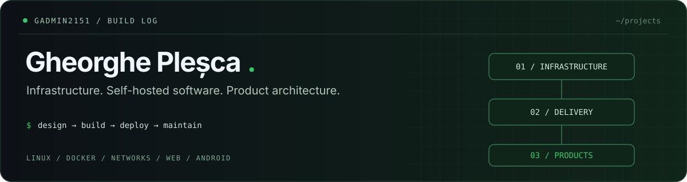

  

  <a href="https://cv.gadmin.md"><strong>CV · experience</strong></a> &nbsp;·&nbsp;
  <a href="https://27g.md"><strong>27G · products</strong></a> &nbsp;·&nbsp;
  <a href="https://github.com/gadmin2151?tab=repositories"><strong>Public repositories</strong></a> &nbsp;·&nbsp;
  <a href="#how-i-build"><strong>How I build</strong></a>

### From infrastructure to useful software

I'm **Gheorghe Pleșca**, a DevOps / infrastructure engineer. I work with Linux servers, networking, containers and self-hosted services, and design software around practical operational needs.

My projects connect **infrastructure**, **desktop and mobile applications**, and **retail systems**. I care about clear architecture, repeatable deployments, controlled changes and documentation that helps people run a project themselves.

### Selected public projects

<table>
  <tr>
    <td width="50%" valign="top">
      <h3><a href="https://github.com/gadmin2151/ambergate">01 / AmberGate</a></h3>
      
<strong>Your applications. One gateway.</strong>

      
A self-hosted Nginx gateway for Docker applications: domain routing, outbound remote agents, TLS and traffic monitoring.

      
<code>Nginx</code> <code>Docker</code> <code>Python</code>

      <a href="https://github.com/gadmin2151/ambergate">Explore the gateway →</a>
    </td>
    <td width="50%" valign="top">
      <h3><a href="https://github.com/gadmin2151/OpenMikroRout">02 / OpenMikroRout</a></h3>
      
<strong>Controlled network changes.</strong>

      
Linux IPv4 routing with WireGuard, firewall/NAT, VLANs and DHCP. Configuration preview, controlled apply and rollback, with nDPI traffic diagnostics.

      
<code>Linux</code> <code>WireGuard</code> <code>iptables</code>

      <a href="https://github.com/gadmin2151/OpenMikroRout">Explore the router →</a>
    </td>
  </tr>
  <tr>
    <td width="50%" valign="top">
      <h3><a href="https://github.com/gadmin2151/sshi">03 / SSHI</a></h3>
      
<strong>SSH through Iroh.</strong>

      
SSH, SFTP and port forwarding through an Iroh relay to a standard OpenSSH server. A Rust transport and CLI, with desktop clients and packaged releases for Linux, macOS and Windows.

      
<code>Rust</code> <code>Iroh</code> <code>OpenSSH</code>

      <a href="https://github.com/gadmin2151/sshi">Explore the connection tools →</a>
    </td>
    <td width="50%" valign="top">
      <h3><a href="https://github.com/gadmin2151/Finora">04 / Finora</a></h3>
      
<strong>A clearer picture of your money.</strong>

      
Self-hosted personal finance with receipt scanning, shared workspaces, a web interface and a native Android application.

      
<code>FastAPI</code> <code>PostgreSQL</code> <code>Kotlin</code>

      <a href="https://github.com/gadmin2151/Finora">Explore the workspace →</a>
    </td>
  </tr>
</table>

### More public projects

| Project                                                        | What it does                                                                           | Delivery                                       |
| :------------------------------------------------------------- | :------------------------------------------------------------------------------------- | :--------------------------------------------- |
| [27G-StorageS3](https://github.com/gadmin2151/27G-StorageS3)   | Experimental self-hosted storage with a partial S3 API, web console and storage nodes. | Docker Compose · persistence and update checks |
| [Cool Assist Ai](https://github.com/gadmin2151/cool-assist-Ai) | Meeting recording and transcription with macOS, Android and Electron clients.          | CI build checks · installer packaging          |
| [ParkedTube](https://github.com/gadmin2151/ParkedTube)         | YouTube for supported Android Auto parked-app screens.                                 | Docker builds · signed APK and SHA-256         |

### Tools I work with

| Layer                    | Tools                                               |
| :----------------------- | :-------------------------------------------------- |
| Systems & virtualization | Linux · Debian / Ubuntu · Proxmox · KVM             |
| Containers & delivery    | Docker · Compose · Git · GitHub Actions · GHCR      |
| Networking & access      | MikroTik · UniFi · WireGuard · Nginx · TLS          |
| Operations & automation  | Zabbix · Graylog · Bash · REST APIs · documentation |

### How I build

**My role:** product ideas, architecture, requirements, technical decisions and directing implementation.

Most of my GitHub projects were designed by me; **Codex / ChatGPT implemented most of their code**. I make that collaboration explicit: the project design and direction are my contribution, and AI assists with implementation.

Practical systems. Clear decisions. Software you can run yourself.

